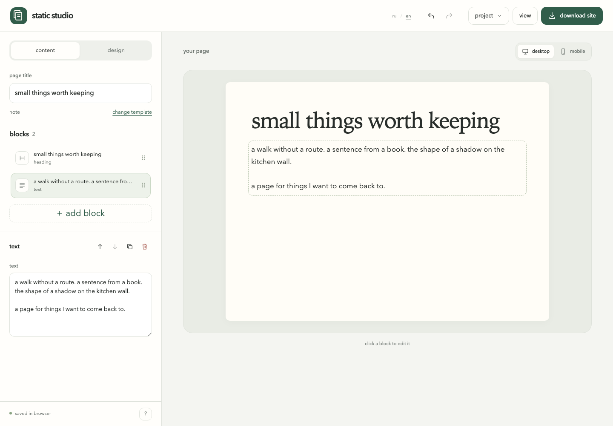
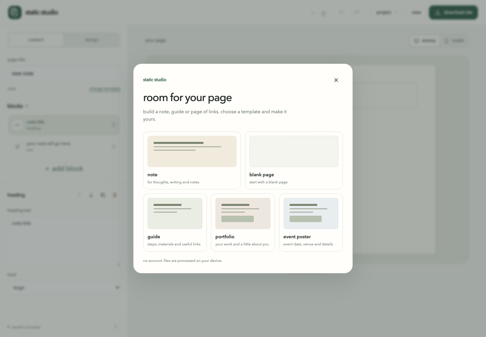
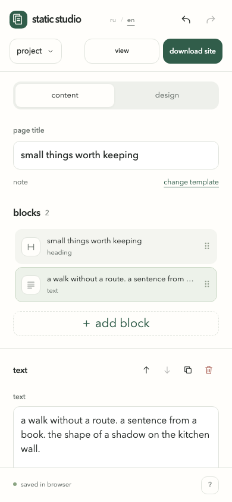

**english** · [русский](README.ru.md)

# static studio

an editor for personal notes and small pages. add text, images and links, preview the result and download a finished page. it runs in your browser, without an account or installation.

[open the editor](https://chebaturkin.github.io/static-studio/?lang=en)



the screenshots show a sample note in the english interface. you can also make a page with a few useful links, a short guide or an event poster.

<details>
<summary>choose a starting point</summary>



</details>

<details>
<summary>the mobile editor</summary>



</details>

## how to use it

1. choose a note or blank page. there are also templates for a guide, portfolio and event poster.
2. change the page title. select a block in the list or click it in the preview to edit.
3. add headings, text, images, links or dividers. a new block appears after the current one.
4. use **design** to choose colours, fonts and width. check desktop and mobile previews.
5. choose **download site**, unzip the archive and open `index.html`.

move blocks with buttons or drag them, duplicate them or delete them. undo restores individual edits and the previous page after choosing a new template.

## keeping your work

changes are saved in this browser’s `localStorage`. choose **project → save project** for a json backup, then **project → open project** to edit it later. clearing browser data removes the local copy. the editor shows a warning if browser storage is unavailable or full.

all files are processed on your device. local images up to 10 mb go into the zip’s `assets/` folder. images linked from another website load from that address and need an internet connection.

use json to continue editing and zip to share the finished page. the zip contains the page, styles and uploaded images. editor hints and empty blocks are left out. to publish, upload the unzipped files to a static host such as github pages. downloading does not publish the site.

## language

**ru / en** lives in the header. a valid `?lang=ru` or `?lang=en` takes priority, then your saved choice, the first supported browser language and english as the fallback. switching preserves your current project, pending text, selection and undo history. fresh, untouched templates follow the selected language. after an edit, import or reload, the page stays as written.

## run and check

open `index.html` directly. running the editor needs no build, dependencies or server. the [example export](examples/en/export/) includes a page you can open locally.

```sh
npm test
node --check app.js
```

browser checks use playwright, which is only needed for development:

```sh
npm install --no-save --package-lock=false playwright
npx playwright install chromium
python3 -m http.server 4184 --bind 127.0.0.1
```

in another terminal:

```sh
npm run test:browser
I18N_URL=http://127.0.0.1:4184 python3 tests/i18n_browser.py
```

open the local editor in [english](http://127.0.0.1:4184/?lang=en) or [russian](http://127.0.0.1:4184/?lang=ru). the language check also needs python’s playwright package and its chromium browser. use `STUDIO_URL` for a different server address. the browser checks cover editing, history, dragging, palettes, images, json, zip, recovery, storage failures, language switching and screen sizes.

shortcuts: `cmd/ctrl + z` undoes an action; `cmd/ctrl + shift + z` redoes it. in the block list, `alt + ↑/↓` changes the order. text fields keep the browser’s normal editing commands. `escape` closes menus and dialogs.

## publish the editor

[pages.yml](.github/workflows/pages.yml) checks the code and publishes application files when `master` or `main` changes. choose **pages → github actions** in repository settings. tests and documentation are not included in the deployment.

## limits

the editor keeps one current page of up to 100 blocks and the last 50 actions in this session. save separate pages as json; imported project files can be up to 15 mb. it has no cloud sync, shared editing, database or one-click publishing. links support `https://`, relative paths and anchors; unsafe protocols are blocked. old v1 and v2 projects still open.
