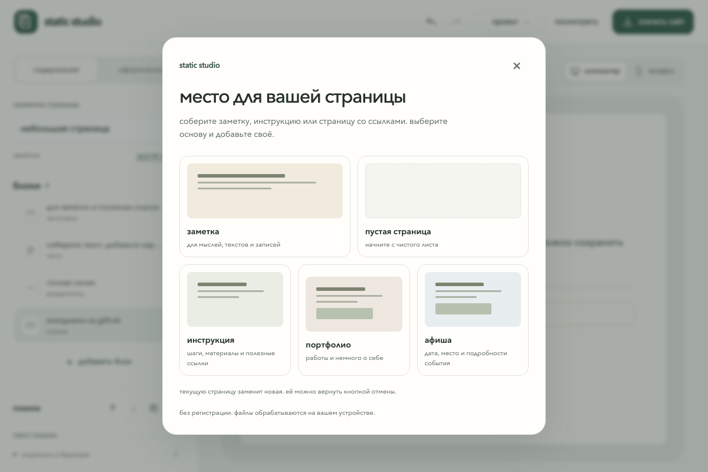

# Static Studio

Static Studio — локальная типографская мастерская для небольших статичных страниц. Соберите текст, изображения и ссылки на одном полотне, настройте ритм и скачайте готовую страницу без сборки и сервера.

## Возможности

- четыре стартовые композиции: заметка, портфолио, афиша и мини-справочник;
- блоки заголовка, текста, изображения, ссылки и разделителя;
- изменение порядка блоков кнопками и с клавиатуры;
- редактируемое название страницы, Undo/Redo и восстановление последнего локального проекта;
- импорт изображений с устройства и локальное хранение данных в проекте;
- предпросмотр страницы рядом с редактором и настройки ширины, цветов и шрифтов;
- экспорт самодостаточного ZIP с `index.html`, `styles.css` и `assets/`;
- сохранение и восстановление проекта через JSON.

Static Studio сохраняет текущий проект в `localStorage`, если браузер разрешает локальное хранилище. Горячие клавиши: `Cmd/Ctrl+Z` — отменить, `Cmd/Ctrl+Shift+Z` или `Cmd/Ctrl+Y` — повторить. История ограничена последними 50 действиями.

Для локальной упаковки подходят PNG, JPEG, GIF, SVG, WebP и AVIF до 10 МБ. Изображения по внешнему HTTPS-адресу остаются внешней зависимостью после ZIP-экспорта — сам файл не скачивается на устройство.

## Локальный запуск

Откройте корневой `index.html` двойным кликом в современном браузере. Static Studio работает прямо из файловой системы: сборка, установка пакетов, сервер, аккаунт и CDN не нужны. Все данные остаются на вашем устройстве; внешних runtime-зависимостей у приложения нет.

Для публикации загрузите содержимое экспортированного ZIP на любой статичный хостинг. Тот же набор файлов можно отправить в GitHub Pages или открыть офлайн после распаковки.

## JSON workflow

1. В редакторе нажмите **Экспорт JSON** и сохраните `static-studio-project.json`.
2. Чтобы продолжить работу, нажмите **Импорт проекта** и выберите этот JSON-файл.
3. JSON содержит шаблон, настройки и блоки проекта; изображения хранятся в нём как локальные data URL.
4. Для передачи только готовой страницы используйте **Экспорт ZIP** — приложение вынесет изображения в папку `assets/`.

## Пример экспортированной страницы

В репозитории есть маленький самодостаточный пример: [открыть `examples/export/index.html`](./examples/export/index.html). Рядом находятся его стили и локальная картинка: [папка `assets/`](./examples/export/assets/).

Чтобы открыть собственный экспорт напрямую:

1. Распакуйте `static-studio-export.zip` в любую папку.
2. Откройте распакованную папку и дважды щёлкните `index.html`.
3. Браузер покажет страницу из локальных `styles.css` и `assets/`; не запускайте сборку, сервер или CDN.

Требуется браузер с поддержкой ES-модулей, File API и загрузок Blob (актуальные Chrome, Firefox, Safari или Edge).

Основное задание и ограничения проекта: [AGENT_PROMPT.md](./AGENT_PROMPT.md).
