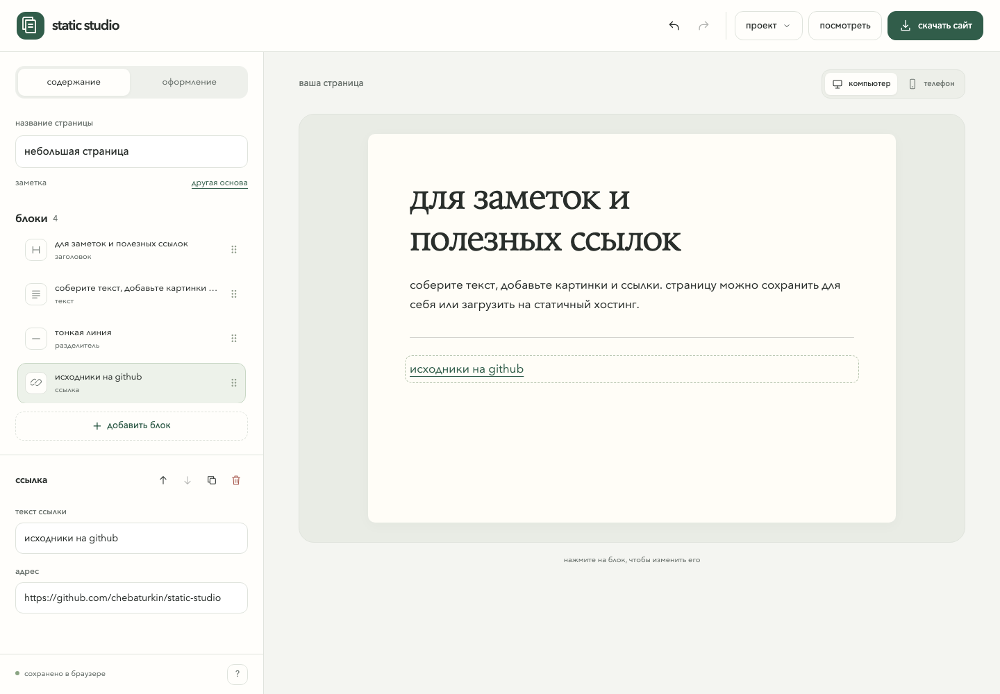
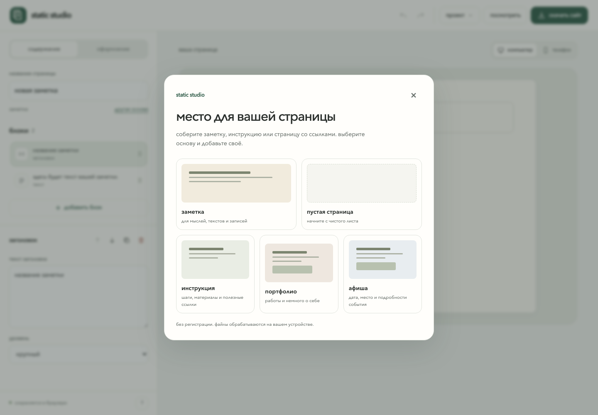
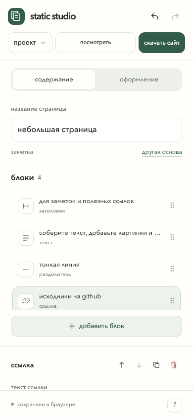

[english](README.md) · **русский**

# static studio

редактор для личных заметок и небольших страниц. добавьте текст, картинки и ссылки, посмотрите результат и скачайте готовую страницу. работает в браузере, без аккаунта и установки.

[открыть редактор](https://chebaturkin.github.io/static-studio/?lang=ru)



на скриншотах показан пример заметки в русском интерфейсе. в редакторе также можно собрать страницу с полезными ссылками, короткую инструкцию или афишу.

<details>
<summary>выбор основы</summary>



</details>

<details>
<summary>редактор на телефоне</summary>



</details>

## как пользоваться

1. выберите заметку или пустую страницу. есть также основы для инструкции, портфолио и афиши.
2. измените название страницы. выберите блок в списке или нажмите на него в предпросмотре, чтобы редактировать.
3. добавьте нужные блоки: заголовок, текст, изображение, ссылку или разделитель. новый блок появится после текущего.
4. во вкладке **оформление** выберите палитру, шрифты и ширину. проверьте вид на компьютере и телефоне.
5. нажмите **скачать сайт**, распакуйте zip и откройте `index.html`.

блоки можно перемещать кнопками или перетаскиванием, копировать и удалять. отмена возвращает и отдельное действие, и предыдущую страницу после выбора новой основы.

## где сохраняется работа

изменения сохраняются в `localStorage` этого браузера. для резервной копии выберите **проект → сохранить проект**. получится json, который можно позже открыть через **проект → открыть проект**. очистка данных браузера удаляет локальную копию. если хранилище недоступно или заполнено, редактор покажет предупреждение.

все файлы обрабатываются на вашем устройстве. локальные изображения до 10 мб попадают в папку `assets/` внутри zip. картинки по внешним ссылкам загружаются с указанного сайта и требуют подключения к интернету.

json нужен, чтобы продолжить редактирование, а zip, чтобы поделиться готовой страницей. zip содержит страницу, стили и загруженные изображения. подсказки редактора и пустые блоки в него не попадают. для публикации загрузите распакованные файлы на статичный хостинг, например github pages. кнопка скачивания сама по себе не публикует сайт.

## запуск и проверка

откройте `index.html` напрямую. сборка, зависимости и сервер для работы не нужны. в [примере экспорта](examples/export/) есть страница, которую можно открыть локально.

проверка логики и экспорта:

```sh
npm test
node --check app.js
```

проверка интерфейса через playwright, установка нужна только для разработки:

```sh
npm install --no-save --package-lock=false playwright
npx playwright install chromium
python3 -m http.server 4184 --bind 127.0.0.1
```

в другом терминале:

```sh
npm run test:browser
I18N_URL=http://127.0.0.1:4184 python3 tests/i18n_browser.py
```

откройте локальный редактор на [русском](http://127.0.0.1:4184/?lang=ru) или [английском](http://127.0.0.1:4184/?lang=en). для проверки языка также нужен пакет playwright для python и его браузер chromium. для другого адреса сервера задайте `STUDIO_URL`. браузерные проверки проходят редактирование, историю, перетаскивание, палитры, картинки, json, zip, восстановление, ошибки сохранения, переключение языка и размеры экрана.

горячие клавиши: `cmd/ctrl + z` отменяет действие, `cmd/ctrl + shift + z` повторяет. в списке блоков `alt + ↑/↓` меняет порядок. в текстовом поле используются обычные команды редактирования браузера. меню и диалоги закрываются клавишей `escape`.

## публикация редактора

workflow [pages.yml](./.github/workflows/pages.yml) проверяет код и публикует файлы приложения при обновлении `master` или `main`. в настройках репозитория выберите **pages → github actions**. исходники, тесты и документация в публикацию не входят.

## границы

редактор хранит одну текущую страницу до 100 блоков и последние 50 действий в этой сессии. отдельные страницы сохраняйте в json; размер загружаемого проекта может быть до 15 мб. здесь нет облачной синхронизации, совместного редактирования, базы данных или публикации в один клик. ссылки поддерживают `https://`, относительные пути и якоря; опасные протоколы блокируются. старые проекты v1 и v2 продолжают открываться.

## язык

язык меняется через ru / en в шапке. явный `?lang=ru` или `?lang=en` важнее сохранённого выбора, затем учитывается первый поддерживаемый язык браузера. по умолчанию используется английский. свежий нетронутый шаблон меняется вместе с языком. после редактирования, импорта или перезагрузки его текст сохраняется как есть. данные, текущие поля и параметры ссылки при переключении остаются на месте.
